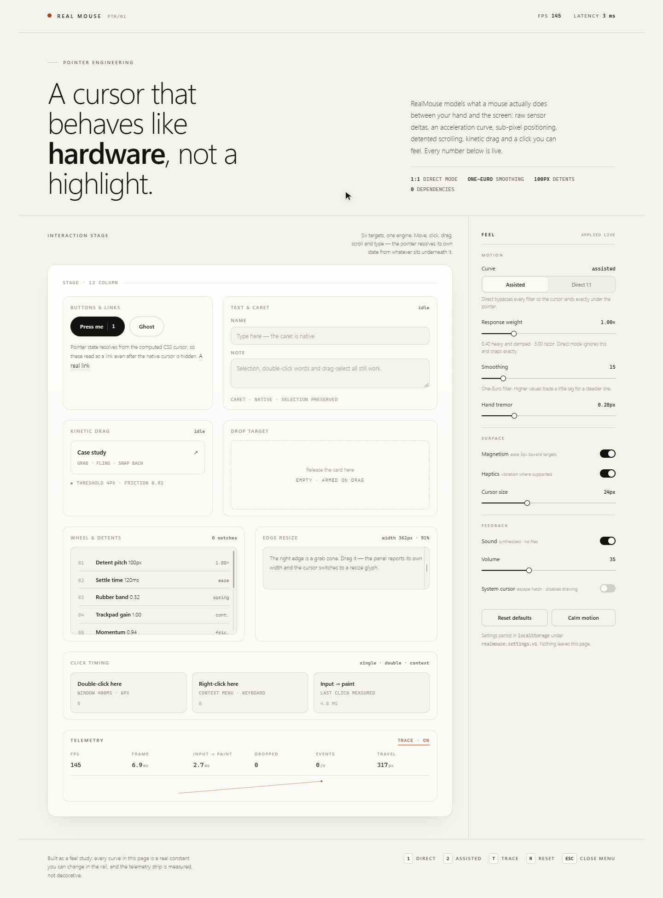

# RealMouse

A browser pointer that behaves like hardware instead of a highlight.

RealMouse is a small, dependency-free feel study: the cursor on screen is a drawn object with
mass and lag, the wheel has notches, drag has momentum, and clicks have a sound and a snap.
Everything is tunable from a live rail, and everything is measured in a telemetry strip that
reports real frame numbers — no decoration, no mock data.



---

## Why it feels like a mouse

A physical mouse is a sensor plus a driver. The sensor reports raw deltas; the driver applies a
curve, filters noise and hands the OS a position. RealMouse reproduces that pipeline in the
browser:

| Stage | What happens | Where |
| --- | --- | --- |
| Raw input | `pointerrawupdate` + `getCoalescedEvents()` so sub-frame samples are not thrown away | `assets/js/engine.js` |
| Weight | Exponential chase: `x += (target − x) · (1 − e^(−λ·dt))` | `engine.js` |
| Curve | `λ = (60 + 300·weightNorm) · (1 − 0.7·smoothingNorm) · (1 + 0.6·speedNorm)` | `engine.js` |
| Direct mode | `λ = ∞` — the cursor is assigned the pointer position, no filter at all | `engine.js` |
| Tremor | Two incommensurate sines + value noise, 0–1.2px, render-only | `engine.js` |
| Sub-pixel | Float coordinates, one composited `translate3d`, never rounded to integers | `cursor.js` |
| Wheel | `deltaMode` normalisation, 100px detents, 0.32 rubber band, spring return | `wheel.js` |
| Drag | 4px threshold, stage clamp with rubber band, spring + fling velocity | `drag.js` |
| Click | 0.90 press scale in 60ms, 220ms release spring, 8px ring, synthesised snap | `cursor.js`, `audio.js` |

`λ` is the only number that decides how the pointer *feels*. At the default weight (1.00) and
smoothing (15) it settles in roughly 8ms — fast enough to feel direct, slow enough to erase
hand tremor. Weight 0.40 is deliberately heavy; weight 3.00 is razor sharp and settled in ~3ms.

## Run it

```bash
node qa/serve.mjs       # http://127.0.0.1:8099
# or
npm run serve
```

There is no build step, no install and no dependency. Opening `index.html` directly works too,
but the QA harness and the module graph expect a server.

## The stage

| Target | What it proves |
| --- | --- |
| Buttons & links | State resolves from the element's computed CSS `cursor`, so a link reads as a hand |
| Text & caret | The drawn I-beam coexists with the native caret, selection and word double-click |
| Kinetic drag | Threshold, lift shadow, fling and spring return |
| Drop target | Hit-testing during drag; the card docks and reports its state |
| Wheel & detents | Device classification, notch snapping, overscroll return |
| Edge resize | A real grab zone with a resize glyph and a width readout |
| Click timing | Single, double (400ms/6px) and a custom context menu with keyboard support |
| Telemetry | FPS, frame time, input→paint latency, dropped frames, events/s, travel |

## Controls

**Mouse** — move, click, double-click, right-click (custom menu), drag the card, drag the resize
edge, wheel over the scroll well.

**Keyboard** — `1` direct · `2` assisted · `T` trace · `R` reset · `Esc` close menu · `Tab`
everywhere (the drawn cursor follows focus so keyboard users still see it) · arrow keys scroll
the focused well · arrow keys resize the focused handle.

**Touch** — a trackpad strip appears on coarse pointers: drag to move, tap to click, long-press
(450ms) for the context menu, two fingers to scroll the page.

## Settings

| Control | Range | Default | Effect |
| --- | --- | --- | --- |
| Curve | Assisted / Direct 1:1 | Assisted | Direct bypasses every filter |
| Response weight | 0.40–3.00× | 1.00× | Chase speed (inertia) |
| Smoothing | 0–100 | 15 | Damps the chase, trades lag for steadiness |
| Hand tremor | 0–1.20px | 0.28px | Render-only analog noise |
| Magnetism | on/off | on | Up to 3px ease toward a nearby target centre |
| Haptics | on/off | on | `navigator.vibrate` where supported |
| Cursor size | 16–40px | 24px | Scales the glyph only |
| Sound | on/off | on | Synthesised click and tick |
| Volume | 0–100 | 35 | Master gain |
| System cursor | on/off | off | Escape hatch: restores `cursor: auto`, stops drawing |

Stored in `localStorage['realmouse.settings.v1']`. Nothing leaves the page: no network calls, no
analytics, no fonts, no images.

## Verify it

```bash
node qa/run.mjs     # drives the installed Chrome over raw CDP, exits 1 on any failure
```

The harness launches headless Chrome, serves the site, dispatches real input events and asserts
the result. Last run on this machine (Chrome, Windows 11, Node 22):

```
PASS  load · console             0 console, 0 exceptions
PASS  load · network             17 requests, 0 external, 0 failed
PASS  motion · direct 1:1        Δx=-0.23 Δy=0.20 (≤1.5), moved=true
PASS  motion · assisted curve    lag during motion 7.5px → settled 0.00px
PASS  click · primary            counter=1
PASS  click · double             double counter=1
PASS  click · context menu       open=true esc-closed=true
PASS  drag · drop                armed=true state="filled · card docked"
PASS  wheel · detents            3 notches, scrollTop=220.1px
PASS  wheel · keyboard           home=0.0 end=220.0
PASS  settings · persist         before=2 after reload=2
PASS  perf · frame budget        median 6.90ms · 144.9fps
PASS  perf · telemetry           median input→paint 4.2ms over 18 samples · coalesced×1.00 · clicks 1
PASS  layout · desktop           overflow=0px stage=879×1197 rail=320px
PASS  layout · tablet            overflow=0px stage=761×1677 rail=761px
PASS  layout · phone             overflow=0px stage=350×1956 rail=350px
PASS  a11y · names               26 controls, 0 nameless
PASS  a11y · focus ring          focus-visible rule present, accent=#a8461c
PASS  capture · screenshots      desktop · tablet · phone

19/19 checks passed
```

Artifacts land in `qa/evidence/`: three full-page PNGs and `report.json` with every measured
value, the Chrome path and the timestamp. `qa/run.mjs` exits non-zero on the first failing
assertion set, so it is safe to use as a pre-push gate.

Two notes on reproducibility:

- input→paint is the only timing-sensitive assertion. It is sampled over 18 sustained moves and
the median is compared against 40ms, so a single scheduler hiccup cannot flip the result.
- The harness needs Chrome or Edge installed. Set `CHROME_PATH` to point at another binary:
`CHROME_PATH="/path/to/chrome" node qa/run.mjs`.

## File map

```
index.html
assets/css/   tokens.css  base.css  cursor-map.css  stage.css  rail.css
assets/js/    math.js  settings.js  audio.js  cursor.js  engine.js
              wheel.js  drag.js  menu.js  telemetry.js  touch.js  main.js
qa/           serve.mjs  cdp.mjs  run.mjs  evidence/
```

`qa/cdp.mjs` is a ~200-line CDP client built on Node 22's global `WebSocket` and `fetch` — that
is why the harness needs no `puppeteer` dependency.

## Accessibility

- The custom cursor is optional; **System cursor** restores the native one instantly.
- Keyboard focus is visible with a 2px accent ring, and the drawn pointer eases to the focused
  element so the two never disagrees.
- The context menu is a `role="menu"` with arrow-key navigation, `Home`/`End` and `Esc`.
- Events are announced through an `aria-live="polite"` region.
- `prefers-reduced-motion` lowers the chase rate, disables tremor and shortens every transition;
  `prefers-contrast: more` strengthens hairlines and text.
- Hit targets are ≥ 32px tall; all controls have real labels.

## Browser support and known limits

- Chrome / Edge 111+ are the reference targets; Firefox is fine for everything except
  `pointerrawupdate` (the engine falls back to `pointermove` automatically).
- Safari has no `pointerrawupdate` and throttles `pointermove` on some hardware, so the assist
  curve will feel smoother than the numbers here suggest.
- Pointer lock is intentionally not used: the drawn cursor always tracks the real pointer so
  clicks, focus and native text selection keep working everywhere.
- Tremor and magnetism are visual only — they never move the hit area.

## Rollback

The project is static and self-contained:

```bash
git revert <commit>      # or: git checkout <previous-tag> -- .
```

Nothing is persisted server-side and the only client state is one `localStorage` key
(`realmouse.settings.v1`). Clearing it returns the page to defaults; the “Reset defaults” button
does the same.

## License

MIT © 2026 Behrad
